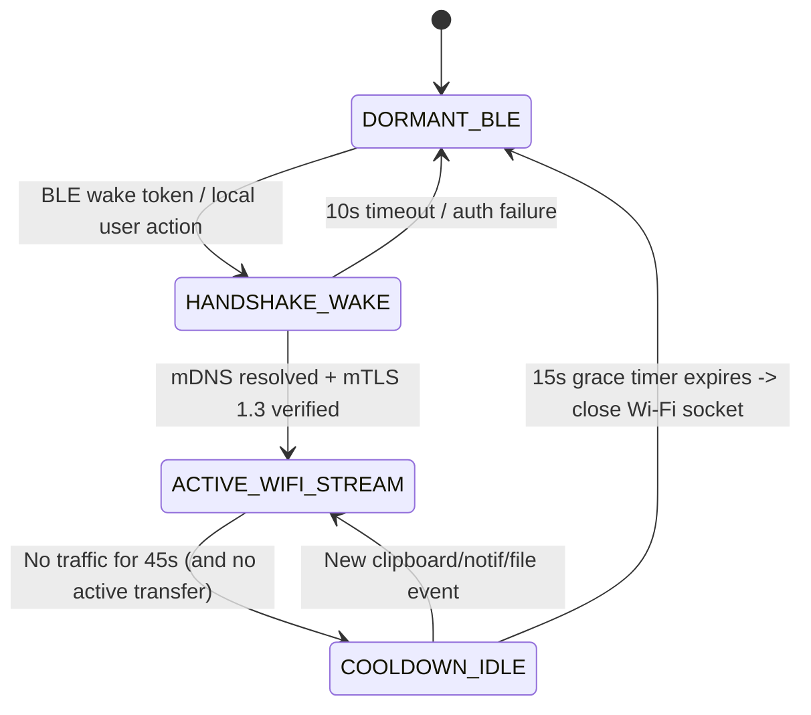

# System Architecture: Link-Me

## 1. High-Level Topology

Link-Me is split into two native applications sharing a strict binary + JSON control protocol defined in [`protocol/schema.json`](../protocol/schema.json) and [`docs/PROTOCOL.md`](./PROTOCOL.md):

* **`macos/` (`MacBridge`)**: Swift 6 + SwiftUI `MenuBarExtra` agent (`LSUIElement = true`) targeting macOS 14+.
* **`android/` (`AndroidBridge`)**: Kotlin + Jetpack Compose app + `connectedDevice` `ForegroundService` targeting Android 10+ (API 29–35).

```
+------------------------------------+            +------------------------------------+
|           macOS (MacBridge)        |            |        Android (AndroidBridge)     |
|                                    |            |                                    |
|  UI: SwiftUI MenuBarExtra + Sheets |            |  UI: Jetpack Compose Activity      |
|  Features: Clipboard / File / Notif|            |  Service: Foreground + NotifList.  |
|  Core/Protocol: WireFrame + JSON   |            |  core/protocol: WireFrame + JSON   |
|  Core/Crypto: CryptoKit + Keychain |            |  core/crypto: JCA + Keystore       |
|  Core/Transport: NWConnection/BLE  |            |  core/transport: SSLSocket / BLE   |
+-----------------+------------------+            +-----------------+------------------+
                  |                                                 |
                  +---- BLE Advertisement (15m rotating HMAC) ------+
                  +---- LAN Wi-Fi (TLS 1.3 mTLS + Binary Frames) ---+
```

---

## 2. 4-State Battery State Machine

Keeping a persistent Wi-Fi TLS socket alive on Android prevents deep Doze sleep and drains battery. Link-Me uses a deterministic 4-state machine across both endpoints:



### State Definitions

| State | Radio & Socket Behavior | Allowed Operations |
| :--- | :--- | :--- |
| **`DORMANT_BLE`** | Wi-Fi TCP/TLS listener closed (or Android server paused). Low-duty BLE scanning/advertising with 15-minute rotating HMAC tokens. | Device presence check, out-of-band `WAKE_WIFI` trigger, Ring request. |
| **`HANDSHAKE_WAKE`** | Initiates mDNS (`_linkme._tcp.local.`) discovery + TCP connect + TLS 1.3 mTLS handshake + `PAIR_HELLO` sequence initialization. | Handshake only. Bounded by a hard **10 s** timeout back to `DORMANT_BLE`. |
| **`ACTIVE_WIFI_STREAM`** | Full-duplex TLS 1.3 stream open. Binary wire frames (`0x01`–`0x09`) exchanged with monotonic `SequenceID`. | Clipboard sync, chunked file transfer, notification mirroring, inline replies, telemetry. |
| **`COOLDOWN_IDLE`** | Entered after **45 s** of inactivity (no active `FILE_CHUNK` transfers). Keeps TLS socket warm for **15 s** to absorb burst edits/replies without re-handshaking, then tears down cleanly to `DORMANT_BLE`. | Immediate promotion back to `ACTIVE_WIFI_STREAM` on any outbound/inbound event; graceful socket close at timer expiry. |

---

## 3. macOS Architecture (`MacBridge`)

* **Deployment Target:** macOS 14.0+ (Sonoma), Swift 6 strict concurrency (`Sendable` actors & value types).
* **App Lifecycle:** `LSUIElement = true` (menu-bar-only agent, no Dock icon). Main surface is a SwiftUI `MenuBarExtra` (`.window` style) plus auxiliary modal windows for QR pairing and incoming file prompts.
* **Module Layout (`macos/`):**
  * `Core/Crypto/`:
    * `Curve25519Pairing.swift`: Ephemeral `Curve25519.KeyAgreement`, `HKDF<SHA256>` key derivation, 6-digit SAS derivation, and `ble_beacon_key` output.
    * `BleTokenAuthenticator.swift`: 15-minute rotating `HMAC-SHA256` token generator and constant-time validator (`±1` window skew tolerance).
    * `KeychainPinningStore.swift`: Stores pinned peer SPKI SHA-256 hashes and local client identity in macOS Keychain (`kSecClassGenericPassword` / `kSecClassIdentity`).
  * `Core/Protocol/`:
    * `WireFrame.swift`: Binary header parser/serializer (`0x414D`, version `0x01`, `MsgType`, `4B Length BE`, `8B SequenceID BE`, `Payload`).
    * `ProtocolPayloads.swift`: Strictly typed `Codable` structs matching `protocol/schema.json`.
    * `SequenceTracker.swift`: Actor enforcing strictly increasing `SequenceID` per session to block replay frames.
    * `FilenameSanitizer.swift`: Path traversal guard for `FILE_OFFER` filenames.
    * `BatteryStateMachine.swift`: Deterministic 4-state transition engine.
  * `Core/Transport/`:
    * `MtlsTransport.swift`: `Network.framework` (`NWListener` / `NWConnection`) configured with TLS 1.3, `sec_protocol_options_set_verify_block` enforcing Keychain-pinned leaf SPKI hashes.
    * `BleWakeManager.swift`: `CoreBluetooth` (`CBCentralManager` / `CBPeripheralManager`) scanning/advertising rotating wake payloads.
  * `Features/`:
    * `ClipboardMonitor.swift`: `NSPasteboard` polling/change-count observer filtering `org.nspasteboard.ConcealedType`, `TransientType`, and `AutoGeneratedType`, plus SHA-256 echo suppression.
    * `FileTransferCoordinator.swift`: Chunked `0x05`/`0x06`/`0x07` sender & staging receiver.
    * `NotificationBridge.swift`: `UNUserNotificationCenter` presenter with inline reply (`UNTextInputNotificationAction`).
    * `TelemetryService.swift`: `IOPSCopyPowerSourcesInfo` battery polling + macOS alert sound ring trigger.
  * `UI/`:
    * `MacBridgeApp.swift`, `MenuBarPopoverView.swift`, `PairingSheetView.swift`.

---

## 4. Android Architecture (`AndroidBridge`)

* **SDK Targets:** `minSdk = 29` (Android 10), `targetSdk = 35` (Android 15).
* **Background Execution:**
  * `BridgeForegroundService` declared with `android:foregroundServiceType="connectedDevice"` to maintain reliable BLE wake and transient Wi-Fi transfers on modern Android OEMs.
  * `BridgeNotificationListenerService` bound via `BIND_NOTIFICATION_LISTENER_SERVICE` to capture actionable notifications and execute `RemoteInput` inline replies.
* **Module Layout (`android/app/src/main/kotlin/com/linkme/androidbridge/`):**
  * `core/crypto/`:
    * `Curve25519Pairing.kt`: X25519 ECDH (`KeyAgreement` / Android KeyPair/HKDF), HKDF-SHA256, 6-digit SAS formatting.
    * `BleTokenAuthenticator.kt`: 15-minute epoch-bucketed `HMAC-SHA256` token generator/verifier.
    * `KeystorePinningManager.kt`: EC/RSA keypair generation in `AndroidKeyStore` + pinned peer SPKI hash persistence in keystore-encrypted store.
  * `core/protocol/`:
    * `WireFrame.kt`, `ProtocolPayloads.kt`, `SequenceTracker.kt`, `FilenameSanitizer.kt`, `BatteryStateMachine.kt`.
  * `core/transport/`:
    * `MtlsTransport.kt`: `SSLContext` (`TLSv1.3`) with custom `X509TrustManager` pinning the paired peer's SPKI SHA-256 hash and disabling hostname-less wildcard trust.
    * `BleWakeManager.kt`: `BluetoothLeAdvertiser` / `BluetoothLeScanner` using `BLUETOOTH_ADVERTISE` and `BLUETOOTH_SCAN`.
    * `NsdDiscoveryManager.kt`: `NsdManager` for `_linkme._tcp.` service registration and resolution.
  * `service/`:
    * `BridgeForegroundService.kt`, `BridgeNotificationListenerService.kt`, `ClipboardSyncManager.kt`.
  * `ui/`:
    * `MainActivity.kt`, `BridgeHomeScreen.kt`, `QrPairingScreen.kt`, `theme/Theme.kt`.
